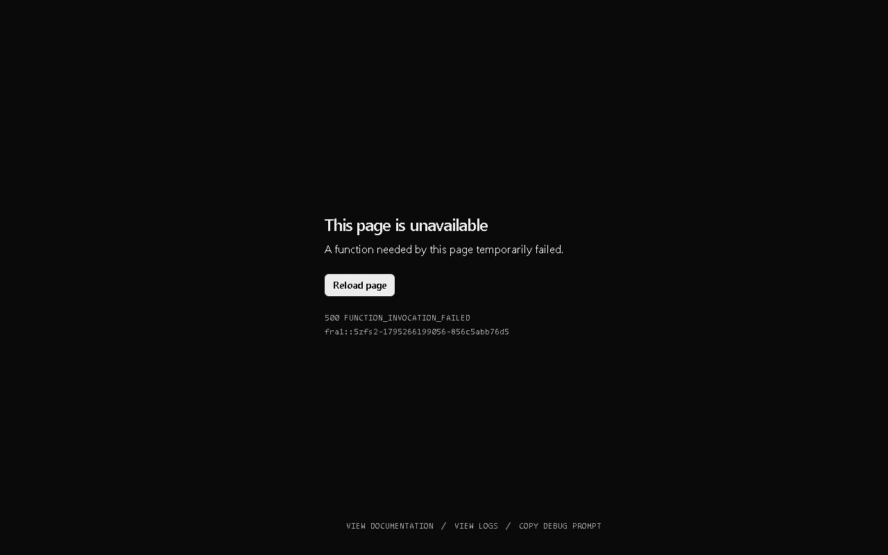

# Bedaya Engineering Industries (بداية للصناعات الهندسية) — Corporate Industrial Website



🌐 **Live Website:** [bedaya-website.vercel.app](https://bedaya-website.vercel.app/)  
👨‍💻 **Web Development & UI Design:** [Mostafa Mohamed Farhat (Elshorbagy)](https://mostafa-portfolio-iota.vercel.app/)

---

## Overview

Corporate web platform and industrial product catalog engineered for **Bedaya Engineering Industries & Feed Mills Construction (`بداية للصناعات الهندسية وإنشاء مصانع الأعلاف`)**, presenting turn-key manufacturing lines, engineering capabilities, and B2B inquiry channels.

### Key Features
- **Industrial Product & Equipment Catalog:** Structured showcase of feed mill machinery, production lines, and engineering services.
- **Corporate Identity & Credentials:** Highlights manufacturing scale, regional project execution, and technical standards.
- **Responsive B2B Layout:** Optimized across desktop, tablet, and mobile viewports.

---

## Tech Stack
- **Frontend:** HTML5, CSS3, JavaScript
- **Server / Local Preview:** Node.js (`server.js`) / Vercel Static & Edge Hosting

---

## Running Locally

```bash
npm install
npm start
```
